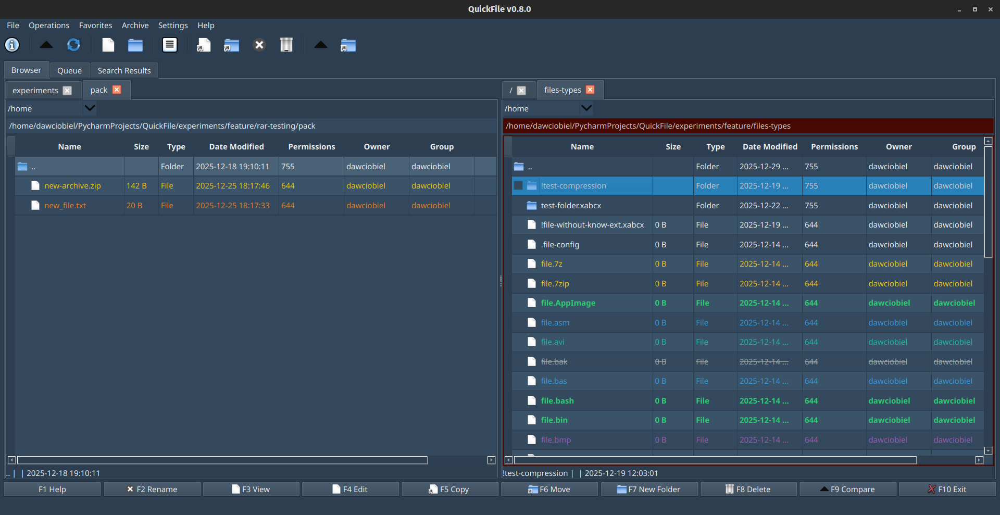

------

# QuickFile - File Manager Application

QuickFile is a modern file manager application built using Python and PyQt5, designed to provide an intuitive, user-friendly interface for managing files and directories on your system. This project aims to simplify file browsing, organization, and management tasks while offering a sleek and responsive experience.

## Features

- **User-friendly Interface**: An easy-to-navigate GUI with a clean design.
- **File Browsing**: Browse and manage files and folders with ease.
- **File Operations**: Supports common file operations such as copy, move, delete, and rename.
- **Search Functionality**: Quickly search for files or directories across the system.
- **Multi-Platform**: Designed to work on Windows, macOS, and Linux (tested on Manjaro).
- **Customization**: Adjustable UI with resizable windows and tables.



## Requirements

- Python 3.9+
- PyQt5
- Additional libraries (listed in `requirements.txt`)

## Installation

To get started, clone the repository and set up a virtual environment:

```bash
git clone https://github.com/dawciobiel/QuickFile.git
cd QuickFile
python3 -m venv .venv
source .venv/bin/activate  # On Windows use .venv\Scripts\activate
pip install -r requirements.txt
```

## Usage

Once the dependencies are installed, run the application:

```bash
python main.py
```

The application window will appear, allowing you to start managing your files.

## Contributing

Feel free to fork this repository, submit issues, or contribute code via pull requests. Contributions are welcome to help improve the functionality, fix bugs, or enhance the user interface.

## License

This project is licensed under the MIT License - see the [LICENSE](https://opensource.org/licenses/MIT) file for details.


------

