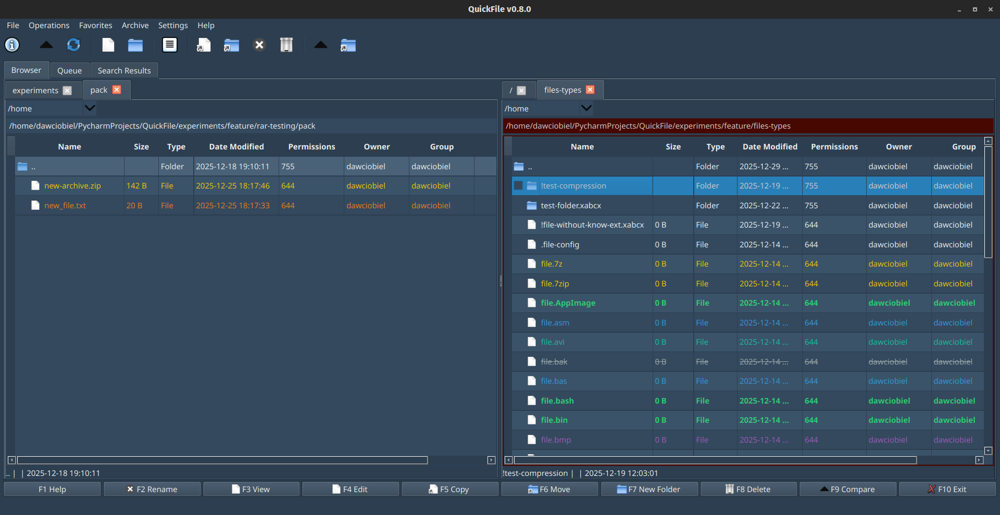

# QuickFile - File Manager Application

QuickFile is a modern file manager application built using Python and PyQt6, designed to provide an intuitive, user-friendly interface for managing files and directories on your system. This project aims to simplify file browsing, organization, and management tasks while offering a sleek and responsive experience.



## Documentation

For detailed information about installation, features, and configuration, please see our [**Full Documentation**](docs/index.md).

## Requirements

- **Linux (recommended):** [Nix](https://nixos.org/) with flakes and, optionally,
  [direnv](https://direnv.net/).
- **Windows / macOS / Linux without Nix:** Python 3.10+ and the packages from
  `requirements.txt`.

The Linux development environment is defined only by `flake.nix`. It already contains
Python 3.12, PyQt6 and every runtime, test and packaging dependency.

## Installation

Clone the repository and enter the Nix development shell:

```bash
git clone https://github.com/dawciobiel/QuickFile.git
cd QuickFile
direnv allow        # or: nix develop
```

Do **not** create a virtual environment or run `pip install` on Linux with Nix: the shell
already provides the correct interpreter and libraries. On first start, QuickFile installs
its bundled plugins into `~/.config/QuickFile/plugins`.

`requirements.txt` is a secondary path for systems without Nix:

```bash
python3 -m venv .venv
source .venv/bin/activate  # On Windows: .venv\Scripts\activate
pip install -r requirements.txt
```

It is not used on Linux with Nix, where `flake.nix` is the single source of truth.
See the [environment guide](docs/developer_guide/environment.md) for details.

## Usage

With the development shell active (or the secondary virtual environment), run:

```bash
python main.py
```

The application window will appear, allowing you to start managing your files.

## Contributing

Please see our [**Contributing Guide**](docs/developer_guide/contributing.md) for details on how to contribute to this project.

**Note:** By contributing to this project, you agree to the terms of the Contributor License Agreement (CLA). This ensures that the project can remain open source while protecting the rights of all contributors. Please see `CLA.md` for details.

## License

This project is licensed under the GNU General Public License v3.0 - see the [LICENSE](LICENSE) file for details.

In case of forks, it is required to preserve author information and clearly mark changes.
